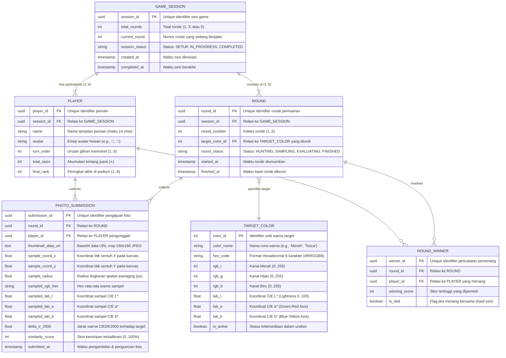

# ENTITY RELATIONSHIP DIAGRAM (ERD) & DATA ARCHITECTURE SPECIFICATION

---

## 📌 Document Metadata
- **Project Name:** Tebak Warna Foto (*Color Match Hunt*)
- **Document Type:** Database Design & Data Model Specification (ERD)
- **Version:** 1.0.0 (Production Architecture)
- **Status:** Approved
- **Scope:** In-Memory Client State & Future Multi-Device / Cloud Relational Schema
- **Associated PRD:** [PRD.md](file:///Users/jevin/Downloads/PRD.md)
- **Repository:** [https://github.com/jevinsyatir007-glitch/tebak-warna](https://github.com/jevinsyatir007-glitch/tebak-warna)

---

## 1. Executive Data Architecture Overview

Aplikasi **Tebak Warna Foto** dirancang dengan arsitektur data **Hybrid State Architecture**:
1. **Current Physical Implementation (Client-Side In-Memory State Machine):** Beroperasi secara lokal di memori peramban (*Canvas API & JavaScript Runtime Object Graph*) dengan prinsip *Zero-Persistence PII* demi kepatuhan privasi anak (COPPA).
2. **Normalized Relational Data Model (Target Schema / Multi-Device Backend):** Skema relasional yang dinormalisasi ke dalam bentuk normal ketiga (**3NF**) untuk mendukung mode sinkronisasi multi-perangkat (*multi-device room session* via WebSocket / Cloud Database di fase v1.2+).

---

## 2. Mermaid Entity Relationship Diagram (Crow's Foot Notation)



---

## 3. Data Dictionary & Detailed Entity Specifications

### 3.1 Entity: `GAME_SESSION`
Menyimpan siklus hidup sebuah sesi permainan dari inisialisasi hingga penyerahan trofi juara.

| Attribute | Data Type | Nullable | Default | Constraints / Enum | Deskripsi & Aturan Bisnis |
|---|---|---|---|---|---|
| `session_id` | UUID | No | `gen_random_uuid()` | Primary Key | Pengenal unik sesi permainan |
| `total_rounds` | SMALLINT | No | `3` | `IN (1, 3, 5)` | Jumlah ronde yang disepakati di awal |
| `current_round` | SMALLINT | No | `1` | `1 <= current_round <= total_rounds` | Posisi ronde aktif saat ini |
| `session_status` | VARCHAR(20) | No | `'SETUP'` | `'SETUP'`, `'IN_PROGRESS'`, `'COMPLETED'` | Status progres permainan |
| `created_at` | TIMESTAMPTZ | No | `NOW()` | - | Waktu pembuatan sesi permainan |
| `completed_at` | TIMESTAMPTZ | Yes | `NULL` | `>= created_at` | Waktu saat layar podium ditampilkan |

---

### 3.2 Entity: `PLAYER`
Entitas partisipan dalam sesi permainan.

| Attribute | Data Type | Nullable | Default | Constraints / Validation | Deskripsi & Aturan Bisnis |
|---|---|---|---|---|---|
| `player_id` | UUID | No | `gen_random_uuid()` | Primary Key | Identifier unik pemain |
| `session_id` | UUID | No | - | Foreign Key $\to$ `GAME_SESSION` | Relasi ke sesi pemilik |
| `name` | VARCHAR(14) | No | `'Pemain'` | Panjang 1–14 karakter | Nama pemain yang tampil di UI |
| `avatar` | VARCHAR(8) | No | `'🐻'` | UTF-8 Emoji valid | Karakter hewan visual |
| `turn_order` | SMALLINT | No | - | `1 <= turn_order <= 6` | Urutan giliran memotret |
| `total_stars` | INT | No | `0` | `>= 0` | Total bintang (⭐) yang dikumpulkan |
| `final_rank` | SMALLINT | Yes | `NULL` | `1 <= final_rank <= 6` | Posisi akhir pada podium pemenang |

---

### 3.3 Entity: `TARGET_COLOR`
Daftar referensi palet warna standar industri yang terkalibrasi ke dalam ruang warna sRGB dan CIE $L^*a^*b^*$.

| Attribute | Data Type | Nullable | Default | Formula / Spesifikasi | Contoh Nilai |
|---|---|---|---|---|---|
| `color_id` | INT | No | Auto | Primary Key | `1` |
| `color_name` | VARCHAR(30) | No | - | Nama warna Bahasa Indonesia | `'Tosca'` |
| `hex_code` | CHAR(7) | No | - | Regex `^#[0-9A-Fa-f]{6}$` | `'#1ABC9C'` |
| `rgb_r` | SMALLINT | No | - | `0 <= r <= 255` | `26` |
| `rgb_g` | SMALLINT | No | - | `0 <= g <= 255` | `188` |
| `rgb_b` | SMALLINT | No | - | `0 <= b <= 255` | `156` |
| `lab_l` | NUMERIC(6,3) | No | - | D65 CIE $L^*$ (0..100) | `67.580` |
| `lab_a` | NUMERIC(6,3) | No | - | D65 CIE $a^*$ | `-46.210` |
| `lab_b` | NUMERIC(6,3) | No | - | D65 CIE $b^*$ | `5.430` |
| `is_active` | BOOLEAN | No | `TRUE` | Menentukan status pemilihan acak | `TRUE` |

---

### 3.4 Entity: `ROUND`
Instansiasi tiap ronde dalam satu sesi permainan.

| Attribute | Data Type | Nullable | Constraints / FK | Deskripsi & Aturan Bisnis |
|---|---|---|---|---|
| `round_id` | UUID | No | Primary Key | Identifier unik ronde |
| `session_id` | UUID | No | FK $\to$ `GAME_SESSION` (`ON DELETE CASCADE`) | Sesi induk dari ronde ini |
| `round_number` | SMALLINT | No | `1 <= round_number <= 5` | Nomor urut ronde |
| `target_color_id`| INT | No | FK $\to$ `TARGET_COLOR` | Warna target yang terpilih di ronde ini |
| `round_status` | VARCHAR(20) | No | `'HUNTING'`, `'TURNS'`, `'RESULT'` | Status fase ronde |
| `started_at` | TIMESTAMPTZ | No | `NOW()` | Waktu ronde dimulai |
| `finished_at` | TIMESTAMPTZ | Yes | `NULL` | Waktu ronde selesai dievaluasi |

---

### 3.5 Entity: `PHOTO_SUBMISSION`
Data hasil foto, koordinat retikel sampling, dan hasil evaluasi matematis CIEDE2000.

| Attribute | Data Type | Nullable | Formula / Validasi | Deskripsi & Rasional Teknis |
|---|---|---|---|---|
| `submission_id` | UUID | No | Primary Key | Identifier unik pengajuan foto |
| `round_id` | UUID | No | FK $\to$ `ROUND` | Ronde terkait |
| `player_id` | UUID | No | FK $\to$ `PLAYER` | Pemain yang memotret |
| `thumbnail_data_url` | TEXT | No | Base64 JPEG data format | Crop bujur sangkar 160×160 piksel bersih tanpa retikel |
| `sample_coord_x` | NUMERIC(7,2) | No | `0 <= x <= canvas.width` | Posisi sumbu X titik ketukan |
| `sample_coord_y` | NUMERIC(7,2) | No | `0 <= y <= canvas.height` | Posisi sumbu Y titik ketukan |
| `sample_radius` | NUMERIC(5,2) | No | `r = max(7, min(w,h) * 0.065)` | Radius filter rata-rata area |
| `sampled_rgb_hex` | CHAR(7) | No | Format `#RRGGBB` | Nilai rata-rata warna yang diambil |
| `sampled_lab_l` | NUMERIC(6,3) | No | Transformasi CIE $L^*$ | Koordinat terang-gelap sampel |
| `sampled_lab_a` | NUMERIC(6,3) | No | Transformasi CIE $a^*$ | Koordinat sumbu hijau-merah sampel |
| `sampled_lab_b` | NUMERIC(6,3) | No | Transformasi CIE $b^*$ | Koordinat sumbu biru-kuning sampel |
| `delta_e_2000` | NUMERIC(6,3) | No | $\Delta E_{00}(k_L=2, k_C=1, k_H=1)$ | Nilai disparitas warna mata manusia |
| `similarity_score` | SMALLINT | No | $\max(0, \min(100, 100 - 2\Delta E))$ | Skor kemiripan akhir (0–100%) |
| `submitted_at` | TIMESTAMPTZ | No | `NOW()` | Waktu tombol 'Kunci ✔' ditekan |

---

### 3.6 Entity: `ROUND_WINNER`
Tabel relasi pemenang ronde untuk mengakomodasi aturan bisnis *Fairness*: Mendukung multi-winner saat terjadi skor seri (*tie-break equality*).

| Attribute | Data Type | Nullable | Constraints / FK | Deskripsi |
|---|---|---|---|---|
| `winner_id` | UUID | No | Primary Key | Identifier entri kemenangan |
| `round_id` | UUID | No | FK $\to$ `ROUND` | Ronde terkait |
| `player_id` | UUID | No | FK $\to$ `PLAYER` | Pemain yang mendapatkan bintang ⭐ |
| `winning_score` | SMALLINT | No | `0 <= score <= 100` | Skor kemenangan pada ronde tersebut |
| `is_tied` | BOOLEAN | No | Default `FALSE` | `TRUE` jika terdapat $\ge 2$ pemenang dengan skor kembar |

---

## 4. Pemetaan State Runtime JavaScript (`index.html`)

Pada implementasi *client-side native*, entitas-entitas di atas dipetakan langsung ke struktur memori JavaScript State Graph sebagai berikut:

```javascript
// Runtime JavaScript State Container
const GameState = {
  // Mapping to GAME_SESSION
  session: {
    totalRounds: 3,        // total_rounds
    round: 1,              // current_round
    status: 'ACTIVE'       // session_status
  },

  // Mapping to Array of PLAYER
  players: [
    { name: 'Pemain 1', avatar: '🐻', points: 0 },
    { name: 'Pemain 2', avatar: '🐰', points: 0 }
  ],

  // Mapping to TARGET_COLOR
  target: {
    name: 'Tosca',
    hex: '#1ABC9C'
  },
  usedTargets: [], // Anti-collision target array

  // Mapping to PHOTO_SUBMISSION per Round
  turn: 0,
  roundShots: [
    {
      player: players[0],
      thumb: 'data:image/jpeg;base64,...',
      rgb: [24.5, 185.2, 154.0],
      score: 96
    }
  ]
};
```

---

## 5. Hubungan Relasi & Aturan Integritas Kardinalitas (Cardinals & Multiplicity)

1. **`GAME_SESSION` ke `PLAYER` (1 to N, mandatory 2..6):**
   - Satu sesi permainan wajib memiliki minimal 2 pemain dan maksimal 6 pemain.
   - Setiap pemain hanya terikat pada tepat 1 sesi aktif.

2. **`GAME_SESSION` ke `ROUND` (1 to N, mandatory 1..5):**
   - Satu sesi terdiri dari 1, 3, atau 5 ronde sesuai konfigurasi awal.
   - Penghapusan sesi (`CASCADE`) menghapus seluruh riwayat ronde terkait.

3. **`TARGET_COLOR` ke `ROUND` (1 to N):**
   - Satu warna target dapat digunakan di berbagai sesi yang berbeda, namun dalam satu sesi yang sama diberlakukan aturan *Sampling without Replacement* (warna tidak berulang hingga palet habis).

4. **`ROUND` ke `PHOTO_SUBMISSION` (1 to N, exactly $N_{\text{players}}$):**
   - Setiap ronde mengumpulkan tepat 1 foto dari masing-masing pemain yang terdaftar.

5. **`ROUND` ke `ROUND_WINNER` (1 to N, $\ge 1$):**
   - Setiap ronde menghasilkan minimal 1 pemenang. Jika terjadi nilai kembar pada peringkat pertama, dibuat beberapa entri `ROUND_WINNER` dengan flag `is_tied = TRUE` dan seluruhnya memperoleh bintang.

---

## 6. Verifikasi & Approval
Spesifikasi skema ERD ini telah disesuaikan dengan logika bisnis kolorimetri pada [PRD.md](file:///Users/jevin/Downloads/PRD.md) dan siap dijadikan landasan arsitektur basis data cloud / API backend.
