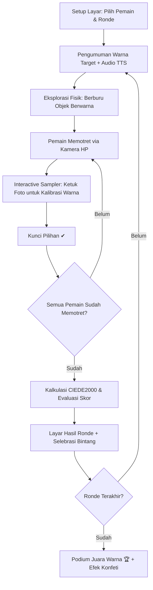

# PRODUCT REQUIREMENTS DOCUMENT (PRD)

---

## 📌 Document Metadata
- **Product Name:** Tebak Warna Foto (*Color Match Hunt*)
- **Version:** 1.0.0 (Production / GA)
- **Status:** Approved & Live
- **Document Author:** Technical Product Team
- **Target Audience:** Family, Children (Ages 4+), Educators, Casual Gamers
- **Live URL:** [https://tebakwarna.streamlit.app/](https://tebakwarna.streamlit.app/)
- **Repository:** [https://github.com/jevinsyatir007-glitch/tebak-warna](https://github.com/jevinsyatir007-glitch/tebak-warna)
- **Architecture Type:** Zero-Server Client-Side Web Application (Single-File Architecture + Streamlit Container Wrapper)

---

## 1. Executive Summary & Problem Space

### 1.1 Executive Overview
**Tebak Warna Foto** adalah aplikasi permainan pesta edukatif multipemain (*pass-and-play party game*) untuk anak-anak dan keluarga. Game ini menghubungkan dunia digital dengan lingkungan fisik nyata: aplikasi menampilkan **satu warna target**, semua pemain berlomba mencari benda di sekitarnya dengan warna serupa, lalu bergiliran memotretnya menggunakan kamera gawai. 

Sistem penilaian menggunakan standar industri kolorimetri **CIEDE2000 (ΔE00)** yang dikalibrasi khusus (*luminance dampening*, $k_L = 2$) untuk mengevaluasi kemiripan warna secara ilmiah, adil, dan instan langsung di perangkat tanpa membutuhkan server.

### 1.2 Problem Statement
1. **Passive Screen Time:** Mayoritas permainan gawai untuk anak mendorong perilaku pasif (menatap layar statis dalam durasi panjang) yang minim interaksi fisik dengan lingkungan sekitar.
2. **Keterbatasan Interaksi Multi-Generasi:** Jarang ada permainan kasual yang dapat dimainkan bersama oleh balita, anak sekolah, orang tua, hingga kakek-nenek dengan kurva belajar (*learning curve*) nol detik.
3. **Privasi & Keamanan Data Anak:** Permainan yang memproses kamera sering kali mengunggah foto ke server cloud, menimbulkan risiko kebocoran privasi (*Child Privacy Compliance / COPPA*).
4. **Ketidakadilan Penilaian Sensor Kamera:** Algoritma RGB Euclidean sederhana sering mendiskriminasi foto di dalam ruangan karena bayangan (*shadows*) dan pencahayaan redup membuat warna tampak jauh lebih gelap daripada aslinya.

### 1.3 Value Proposition
- **Aktif & Kinestetik:** Mendorong anak aktif bergerak mengeksplorasi ruangan dan mengenali warna objek nyata.
- **100% On-Device & Zero-Data Transfer:** Foto diproses secara lokal di memori browser (Canvas API) tanpa transmisi jaringan, menjamin privasi keluarga 100%.
- **Sains Warna Akurat (CIEDE2000):** Penilaian berbasis persepsi visual mata manusia yang objektif dan adil dalam berbagai kondisi cahaya ruangan.
- **Instalasi Nol:** Cukup satu tautan web, langsung dapat dimainkan di peramban HP Android maupun iOS Safari.

---

## 2. User Personas

| Persona | Profil | Kebutuhan Utama | Nilai yang Ditawarkan |
|---|---|---|---|
| **Anak (4–9 Tahun)** | Pengguna akhir utama, belajar mengenal konsep spektrum warna dan nama benda. | Antarmuka ceria, kontrol sentuh intuitif, tombol besar, audio berbahasa Indonesia, karakter hewan lucu. | Visual imersif, audio pemandu ramah, animasi selebrasi bintang dan piala. |
| **Orang Tua / Keluarga** | Fasilitator permainan di rumah atau saat kumpul keluarga. | Pengoperasian gampang, tanpa registrasi akun, aman untuk anak, tidak mengonsumsi kuota data berlebih. | *Pass-and-play* satu HP, privasi terjamin, aturan permainan instan dipahami. |
| **Guru PAUD / TK** | Pendidik usia dini yang mencari metode interaktif *gamified learning*. | Media ajar pengenalan warna dan melatih ketelitian visual serta motorik anak. | Dapat dimainkan di tablet kelas, mode 1–6 pemain bergantian. |

---

## 3. Product Goals & Success Metrics (KPIs)

### 3.1 Business & Product Objectives
- Menghadirkan permainan edukasi warna keluarga paling ringan, cepat, dan aman di web.
- Menyediakan arsitektur *zero-latency* dan *zero-operational-cost* (serverless & cloud-cost free).

### 3.2 Key Performance Indicators (KPIs)
- **Time-to-Interactive (TTI):** < 1.2 detik pada jaringan 4G mobile.
- **Color Extraction Latency:** < 16ms (60 FPS real-time pointer tracking).
- **Session Completion Rate:** > 85% sesi permainan diselesaikan hingga podium akhir.
- **User Privacy:** 0 byte data foto atau identitas ditransmisikan ke server eksternal.

---

## 4. Game Architecture & Core Loop

---

## 5. Functional Requirements (FR)

### FR-01: Multi-player Configuration & Profiling
- **FR-01.1:** Mendukung **2 hingga 6 pemain** dalam satu sesi *pass-and-play*.
- **FR-01.2:** Pemilihan avatar hewan lucu secara otomatis (`🐻`, `🐰`, `🦊`, `🐼`, `🐸`, `🐯`).
- **FR-01.3:** Kustomisasi nama pemain hingga 14 karakter per pemain dengan fallback otomatis (*"Pemain 1"*, *"Pemain 2"*, dst.).
- **FR-01.4:** Konfigurasi durasi permainan fleksibel: **1 ronde** (cepat/balita), **3 ronde** (standar), atau **5 ronde** (turnamen).

### FR-02: Target Color Selection Engine
- **FR-02.1:** Warna target dipilih secara acak dari database palet terkalibrasi (`TARGETS`) tanpa pengulangan warna dalam satu sesi permainan (*sampling without replacement*).
- **FR-02.2:** Target mencakup palet familiar:
  - Merah (`#E63946`)
  - Kuning (`#F7C600`)
  - Hijau (`#2EB872`)
  - Biru (`#2F80ED`)
  - Oranye (`#FF8A1F`)
  - Ungu (`#9B51E0`)
  - Pink (`#FF6FAE`)
  - Tosca (`#1ABC9C`)
  - Cokelat (`#8B5A2B`)
  - Putih (`#F4F4F4`)
  - Hitam (`#222222`)

### FR-03: Hardware Camera & Media Ingestion
- **FR-03.1:** Menggunakan atribut HTML5 native `<input type="file" accept="image/*" capture="environment">` untuk langsung membuka kamera belakang ponsel.
- **FR-03.2:** Kompatibel dengan fallback file picker pada laptop atau peramban desktop.
- **FR-03.3:** Image Decoupling & Downscaling: Gambar yang ditangkap dikompresi ke resolusi optimal ($max(w, h) \le 700\text{px}$) pada Canvas untuk menjamin pemrosesan 60 FPS tanpa menguras RAM HP.

### FR-04: Interactive Color Sampling & Visual Reticle
- **FR-04.1:** Retikel penargetan dinamis ditampilkan di atas kanvas foto.
- **FR-04.2 (Spatial Averaging Filter):** Nilai warna tidak hanya mengambil 1 piksel (yang rentan terhadap *sensor noise*), melainkan menghitung rata-rata lingkaran area ($r \approx 6.5\%$ dari dimensi kanvas):
  $$\bar{C} = \frac{1}{N} \sum_{(x - c_x)^2 + (y - c_y)^2 \le r^2} C(x, y)$$
- **FR-04.3:** Pemain dapat mengetuk bagian mana pun pada foto untuk memindahkan titik retikel sebelum mengunci pilihan.
- **FR-04.4:** Pratinjau langsung perbandingan warna berdampingan (*Side-by-side Chip: Target vs Fotomu*) dan estimasi skor *live*.

### FR-05: Industrial-Grade Colorimetry Engine (CIEDE2000)
- **FR-05.1 (sRGB ke CIE XYZ):** Transformasi warna non-linear sRGB (D65 illuminant, $2^\circ$ standard observer) dengan *gamma expansion*:
  $$V_{\text{linear}} = \begin{cases} \frac{V}{12.92}, & \text{jika } V \le 0.04045 \\ \left(\frac{V + 0.055}{1.055}\right)^{2.4}, & \text{jika } V > 0.04045 \end{cases}$$
- **FR-05.2 (CIE XYZ ke CIE $L^*a^*b^*$):** Transformasi ke persepsi ruang warna Lab dengan *reference white* $X_n = 95.047$, $Y_n = 100.000$, $Z_n = 108.883$.
- **FR-05.3 (Kalkulasi $\Delta E_{00}$ dengan $k_L = 2$):** Jarak warna dihitung menggunakan formula standar industri **CIEDE2000**:
  $$\Delta E_{00} = \sqrt{\left(\frac{\Delta L'}{k_L S_L}\right)^2 + \left(\frac{\Delta C'}{k_C S_C}\right)^2 + \left(\frac{\Delta H'}{k_H S_H}\right)^2 + R_T \left(\frac{\Delta C'}{k_C S_C}\right) \left(\frac{\Delta H'}{k_H S_H}\right)}$$
  *Rasional Bobot $k_L = 2$:* Mereduksi penalti perbedaan terang-gelap (*lightness difference*) hingga 50%, sehingga foto anak di dalam ruangan dengan lampu redup tetap mendapatkan skor yang adil selama rona warna (*hue*) dan kejenuhan (*chroma*) tepat.
- **FR-05.4 (Pemetaan Skor Persentase):**
  $$\text{Skor Kemiripan} = \max(0, \min(100, \text{round}(100 - 2 \times \Delta E_{00})))\%$$

### FR-06: Dual-Engine Audio & Speech Feedback
- **FR-06.1 (Voice Narration):** Web Speech API (`SpeechSynthesis`) berbahasa Indonesia (`id-ID`) untuk pemandu interaktif ("Ayo cari benda berwarna Merah!", sebutan pemenang tiap ronde).
- **FR-06.2 (Web Audio API Synthesizer):** Efek suara sintetis tanpa aset audio eksternal:
  - *Click / Pop:* 660–720 Hz saat memilih tombol atau mengetuk foto.
  - *Lock Chord:* Chord C-E (523–659 Hz) saat mengunci foto.
  - *Victory Fanfare:* Arpeggio C-E-G (523–659–784 Hz) saat pengumuman ronde.
  - *Grand Finale:* C-E-G-C (523–659–784–1046 Hz) saat podium juara.
- **FR-06.3:** AudioContext auto-unlock pada interaksi pengguna pertama untuk mematuhi kebijakan autoplay browser modern (iOS Safari & Chrome Mobile).

### FR-07: Gamification, Scoring, & Tie Handling
- **FR-07.1:** Skor tertinggi dalam ronde otomatis memenangkan 1 bintang (`⭐`).
- **FR-07.2 (Fairness Rule):** Jika terjadi hasil seri (*tie*), **seluruh pemain dengan skor tertinggi bersama** berhak menerima 1 bintang emas.
- **FR-07.3:** Papan klasemen akhir menampilkan ranking medali (`🥇`, `🥈`, `🥉`) dan total perolehan bintang.

---

## 6. Non-Functional Requirements (NFR)

### 6.1 Performance & Latency
- Ukuran total payload aplikasi **< 35 KB** (gzipped), sehingga dapat dimuat seketika bahkan pada koneksi 3G.
- Pengambilan sampel warna dan kalkulasi CIEDE2000 membutuhkan waktu **< 5 ms**.

### 6.2 Security, Privacy, & Compliance
- **Zero Data Collection:** Tidak ada pelacak (*trackers*), analitik pihak ketiga, atau transmisi gambar.
- **In-Memory Volatility:** Foto pemain hanya disimpan sementara di RAM kanvas browser dan langsung dihapus saat sesi permainan direset.
- **Compliant with COPPA & GDPR-K:** Sepenuhnya aman dan ramah privasi anak.

### 6.3 Usability & Ergonomics
- **Touch Targets:** Minimal dimensi tombol interaktif $\ge 48 \times 48\text{px}$ untuk kenyamanan jari anak-anak.
- **Typography:** Menggunakan *Google Font Baloo 2* yang membulat, ramah anak, dan memiliki keterbacaan tinggi.
- **Responsive Layout:** Dioptimalkan secara vertikal (*portrait mobile-first*) dengan batas kontainer maksimal 760px pada tablet dan desktop.

---

## 7. Technical Architecture & Deployment Models

### 7.1 Single-File Native Architecture (`index.html`)
- Menggabungkan HTML5 Semantik, CSS3 responsif, dan Vanilla JavaScript ES6+ dalam satu file tunggal.
- Tidak memiliki dependensi build tool (`npm`, `webpack`, dll) — siap di-host langsung di **GitHub Pages**, Cloudflare Pages, atau dibuka offline langsung di peramban gawai.

### 7.2 Streamlit Cloud Container Architecture (`app.py`)
- Membungkus game menggunakan `streamlit.components.v1.html`.
- Menginjeksi CSS untuk menyembunyikan header/footer bawaan Streamlit guna memberikan pengalaman *full-app immersion*.
- Dideploy langsung via **Streamlit Community Cloud** dengan konfigurasi otomatis via `requirements.txt`.

---

## 8. Release Roadmap (Future Phases)

| Fase | Target | Fitur Utama |
|---|---|---|
| **v1.1** | Q4 2026 | - Mode Buta Warna (*Color Vision Deficiency Simulation*) - Opsi kustomisasi tema warna kustom via UI. |
| **v1.2** | Q1 2027 | - Multi-Device P2P Sync (WebRTC) agar pemain dapat memotret memakai HP masing-masing tanpa harus bergantian 1 HP. |
| **v2.0** | Q2 2027 | - Edge AI Computer Vision (TensorFlow.js) untuk memverifikasi apakah objek yang difoto sesuai dengan nama benda yang ditantang. |

---

## 9. Sign-off & Approval
Dokumen ini menjadi acuan spesifikasi resmi untuk pemeliharaan, audit kualitas kode, dan pengembangan fitur lanjutan game **Tebak Warna Foto**.
